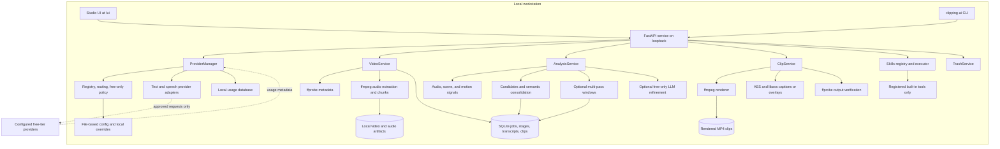

# Personal Clipping Studio — Project Overview

> **Document purpose:** Give a technically grounded, shareable overview of what Personal Clipping Studio is, what is implemented, how it works, what evidence exists, and what must not be overclaimed.
>
> **Evidence basis:** Local repository source, tests, configuration, existing project documents, offline evaluation artifacts, and the completed Phase 6C.1 reliability work. No live provider calls, migrations, destructive commands, or application changes were made to produce this overview.
>
> **Status date:** 2026-11-23.
>
> **Status labels used below:** `Implemented` means present in code with tests or strong source evidence; `Partial` means present but bounded, opt-in, heuristic, or not fully validated; `Planned` means not implemented; `Unverified` means evidence exists in documentation but not in the current local run or code path; `Stale docs` means checked-in documentation conflicts with the current implementation.

## A. Executive Summary

Personal Clipping Studio is a **local-first video-to-clips workstation**. It combines a free-tier-only AI provider layer, a ffmpeg-based video preparation engine, transcription and highlight discovery, source-preserving clip rendering, optional Arabic/English burned-in captions, restrained automatic visual effects, editing metadata, publishing status, trash/recovery, and a packaged vanilla browser UI.

The system is designed for one operator on one machine. It has no hosted control plane, no shared database, no external queue, no provider-side proxy, and no paid-model fallback. The backend is a FastAPI service and CLI; the frontend is a static ES-module application served by the same process at `/ui/`. SQLite holds job state, stage checkpoints, transcripts, highlights, clip jobs, and local usage records.

The core value proposition is **controlled, inspectable local automation**: ingest a long source video, see what the pipeline is doing, transcribe and detect candidate moments, review or adjust ranges, export vertical/square/landscape MP4s, and recover interrupted work without sending media to a hosted editor or generating synthetic media.

The latest completed milestone is **Phase 6C.1 — Multi-pass Resilience Hardening and Regression Baseline**. **Phase 6D — Full-Video Coverage and Diversity-Aware Candidate Selection — is not implemented as a named phase.** Current code does include opt-in multi-pass window discovery, aggregation, and bounded diversity scoring; these should be described as implemented primitives, not as a proven guarantee of complete full-video coverage quality.

## B. Product Context, Problem, and Target User

| Item | Summary |
| --- | --- |
| Target user | A single local operator at a personal editing workstation. |
| Job to be done | Turn a prepared local video into a small set of reviewable, downloadable short-form clips with minimal ceremony. |
| Problem | Manual review of long recordings is slow; hosted editors move media off-machine; generic AI dashboards hide pipeline state, provider eligibility, and failure/recovery details. |
| Product response | Keep the source local, expose every stage, enforce a free-only provider policy, preserve original media/audio, and make cancel/retry/restore actions first-class. |
| Brand personality | Calm, exacting, local-first; a quiet control room and editorial desk, not a neon AI dashboard. |
| Non-goals | No hosted UI, no shared collaboration, no paid usage, no synthetic voice/video, no automatic social upload, no multi-user auth model. |

The operator can work through the CLI, the API, or the browser UI. The UI is intended to make the pipeline legible: service status, provider readiness, queue state, storage behavior, job stages, transcript context, highlight evidence, clip status, and local usage are part of the product rather than hidden internals.

## C. Solution Overview and End-to-End Workflow

1. **Configure local providers.** The operator maintains a file-based registry of providers, models, routing, and policy. A model is executable only if explicitly registered, enabled, marked free, and eligible for the requested task.
2. **Ingest a source.** The system accepts a local upload or an HTTP/HTTPS URL, validates type/size/scheme, detects duplicates, stores the original under a per-job directory, probes metadata with ffprobe, extracts audio, and creates timestamped chunks.
3. **Transcribe.** A free-approved speech provider produces timestamped segments and optional word timestamps. Completed chunks are cached so failed transcription can resume.
4. **Detect highlights.** Transcript and ffmpeg audio/scene/motion signals feed weighted candidate windows. Optional structured LLM refinement proposes complete moments; deterministic selection remains the fallback. Content type may be auto-classified or explicitly supplied.
5. **Discover across a long video.** Single-pass discovery remains default. Opt-in multi-pass mode partitions the video into stable windows, persists a discovery plan, analyzes/reuses per-window artifacts, aggregates candidates, consolidates boundaries, deduplicates, applies diversity scoring, and caps final highlights.
6. **Review and export.** The UI shows transcript, classification, detected ranges, confidence, signals, and a source preview/trim editor. The operator chooses ranges or highlight indices, formats, quality, fit, captions, language, and visual settings.
7. **Render clips.** Clip jobs cut from the original source, build optional ASS captions and overlays, apply evidence-gated effects, write atomic `.part.mp4` outputs, verify them with ffprobe, and only then mark them ready.
8. **Finalize locally.** Titles, descriptions, hashtags, language, and publishing state are editable. Publishing is a manual local status; there is no upload integration. Sources and clips can be soft-deleted, restored, permanently deleted, or emptied from a unified Trash.

## D. Capability Inventory and Status

| Capability | Status | Notes |
| --- | --- | --- |
| Free-only provider routing and last-line guard | Implemented | Registry membership, explicit free approval, enablement, task support, provider availability, and pre-call checks. |
| Text providers: LiteLLM and OpenAI-compatible gateways | Implemented | Gemini/OpenRouter/Groq text via LiteLLM; explicit configured free gateways via generic adapter. |
| Speech providers: Groq Whisper and optional whisper.cpp | Implemented / Partial | Groq path is integrated with chunk cache; whisper.cpp is implemented but optional and requires an existing binary/model. |
| NVIDIA free endpoint discovery | Implemented / Partial | Structured catalog discovery, filtering, cache, and bounded smoke verification exist; live inference requires an operator key and was not run here. |
| Structured output validation and repair | Implemented | JSON extraction, Pydantic schema validation, bounded repair retries. |
| Local usage tracking, throttling, retries, cooldowns | Implemented | Local counters are guards, not provider-side quota truth. |
| Video upload/URL ingestion, metadata, audio, chunks | Implemented | ffmpeg/ffprobe based; local job persistence and one worker. |
| Transcription with resumable chunks | Implemented | SQLite chunk cache and offset-aware merge. |
| Confidence-gated content classification | Implemented / Partial | Podcast, educational, general, gaming, live, mixed, unknown; heuristic and explicitly overridable. |
| Transcript/signal candidate generation | Implemented | Audio energy, silence transitions, peaks, scene changes, motion, transcript gaps, weighting, dedupe. |
| Semantic consolidation and sentence-boundary splitting | Implemented / Partial | Heuristic consolidation using gaps, continuity markers, and lexical overlap; not topic modelling or diarisation. |
| Optional LLM refinement with deterministic fallback | Implemented | Free-only; invalid/failed refinement falls back. |
| Opt-in multi-pass discovery | Implemented / Partial | Plan artifact, per-window stages, fingerprints, leases, cached aggregate, diversity scoring; cost and quality tradeoffs remain. |
| Clip rendering: vertical, square, landscape | Implemented | H.264/AAC MP4, atomic writes, ffprobe verification, retry/cancel/cleanup. |
| Dynamic captions and Arabic RTL | Implemented | libass/ASS, word-timestamp phrase cues, current-word accent, restrained emphasis, Arabic shaping, no manual text reversal. |
| Evidence-gated visual effects and composition | Implemented / Partial | Smoothstep zoom/punch/emphasis/fades and at most one callout; subjective polish still needs human review. |
| Clip metadata generation and manual publishing | Implemented | Bounded free-provider batches, local fallback, manual-edit protection, manual published status, source completion counts. |
| Unified Trash | Implemented | Soft delete, restore, permanent delete, empty; guarded by ownership and deleted-state checks. |
| Data-only Skills/Tools | Implemented | Registered built-in tools only; external manifests disabled until review; permissions and timeouts enforced. |
| Packaged studio UI | Implemented | Static ES modules, no Node build step, English/Arabic RTL, responsive navigation, dialogs, toasts, scoped polling. |
| Source preview and custom trim ranges | Implemented / Stale docs | Current UI/API support `ranges`; some checked-in docs still state no custom trim control or source streaming. |
| Phase 6D named roadmap item | Planned | Not implemented; do not present as shipped. |

## E. Architecture Diagram

The process boundary is the local machine. External network calls are limited to explicitly configured provider tasks, URL ingestion, and catalog/verification operations where enabled. Media remains in local storage.

## F. Backend Component Map

| Area | Key modules | Responsibility |
| --- | --- | --- |
| Settings | `clipping_ai/settings.py` | Environment/`.env`, secret handling, local storage roots, loopback host/port defaults. |
| API | `clipping_ai/api/app.py` |FastAPI routes, request models, AIError-to-HTTP mapping, CORS, jobs, service wiring, packaged UI mount. |
| Registry and policy | `clipping_ai/registry.py`, `routing.py`, `policy.py` | Provider/model validation, free allow-list, routing, fallback rules, retry policy, local overrides. |
| Provider orchestration | `clipping_ai/manager.py`, `structured.py`, `schemas.py`, `providers/` | Task execution, adapters, structured output, throttling, usage, verification, error normalization. |
| Video engine | `clipping_ai/video/` | Upload/URL validation, job store, metadata, audio/chunks, worker, source paths. |
| Analysis | `clipping_ai/analysis/` | Transcription orchestration, highlight settings, durable analysis stages, multi-pass progress. |
| Highlight logic | `clipping_ai/highlights/` | Signals, classification, candidates, semantic consolidation, LLM refinement, multi-pass aggregation, observability. |
| Clip engine | `clipping_ai/clips/`, `clipping_ai/composition/` | Clip jobs, render plans, ASS captions, visual settings, overlays, metadata, publishing state. |
| Recovery | `clipping_ai/recovery/` | StageStore, fingerprints, leases, idempotency, startup reconciliation, stale temp cleanup. |
| Skills | `clipping_ai/skills/` | Data-only manifests, safe IDs, tool permissions, review state, bounded execution. |
| Trash | `clipping_ai/trash.py` | Unified source/clip soft delete, restore, permanent deletion, per-item results. |
| CLI | `clipping_ai/cli.py` | Local commands for status, providers, models, usage, prepare, transcribe, analyze, render, retry, cancel, jobs. |

## G. AI Provider Layer and Free-Tier Policy

The provider layer answers one central question: **which approved free provider/model should execute this task, and how should validation, fallback, retry, and usage tracking work?**

### Enforcement layers

A provider call is allowed only after:

1. Registry membership in `config/models.json` or an accepted local override.
2. Explicit `free: true` approval.
3. Enabled model and provider status.
4. Requested task support.
5. Optional verified-free policy.
6. Provider availability and configured credentials.
7. A last-line free check immediately before execution, also enforced in adapters.
8. Free-only fallback; paid fallback and arbitrary model strings are rejected.

### Provider types

- `litellm`: text tasks through configured Gemini, OpenRouter, and Groq text models.
- `openai_compatible`: explicitly configured free gateways with an explicit base URL and bearer key; no inferred URL or model.
- `groq_speech`: speech-to-text with verbose JSON timestamps, optional ffmpeg chunking, and a SQLite chunk cache.
- `whisper_cpp`: optional local subprocess provider; no automatic download; precise health states such as ready, not installed, model missing, misconfigured, error, disabled, or unavailable.

### Cost and quota behavior

- Quota exhaustion blocks the exhausted provider using provider-reported retry windows, next-UTC-midnight handling for daily quotas, or conservative local cooldowns.
- Local daily counters are guards, not authoritative remaining quota.
- Missing credentials disable only the affected provider; the service still starts.
- Provider pricing and free-tier terms can change, so registry verification must be maintained.
- NVIDIA Free Endpoint resources remain unverified until a bounded smoke test succeeds.

## H. Video, Analysis, and Highlight Pipeline

### Video preparation

1. Validate upload filename/extension or URL scheme.
2. Stream and hash uploads; detect duplicates; enqueue URL downloads with `yt-dlp`.
3. Probe duration, container, size, bit rate, and stream details.
4. Extract one normalized audio track with configured codec/rate/channels.
5. Create timestamped chunks with explicit offsets and durations.
6. Persist artifacts and progress under local per-job directories.

No transcription, highlight detection, or rendering occurs inside the preparation worker.

### Transcription and single-pass analysis

1. Require a prepared job.
2. Transcribe through a free speech model; cache completed chunks.
3. Normalize and clamp transcript timestamps; optionally filter low-probability words.
4. Compute audio, scene, and motion signals; audio-only media skips visual signals with notes.
5. Classify content with confidence gating and source hints.
6. Build weighted transcript and signal candidates.
7. Optionally refine through the `highlight_detection` task.
8. Apply semantic consolidation, long-moment splitting, dedupe, ranking, and final caps.
9. Store highlights, classification evidence, per-highlight signals, and errors.
10. Never modify or replace the source video or speaker audio.

### Multi-pass discovery

`MultiPassSettings` is disabled by default. When enabled, the runner:

- plans deterministic stable window IDs from duration, `window_seconds`, and `overlap_seconds`;
- persists a `discovery.plan` artifact with effective settings, windows, and fingerprints;
- scopes transcripts and signals to each window while preserving absolute timestamps;
- validates that window LLM highlights stay within the window;
- stores each window as a durable stage with lease ownership and validated artifacts;
- aggregates window outcomes plus deterministic candidates;
- applies global dedupe, consolidation, splitting, category/temporal diversity penalties, and the highlight cap;
- reports progress with statuses such as planned, running, stale, completed, and reused.

Known boundary: a stale or invalid aggregate currently causes conservative global invalidation rather than localized replacement of only the affected window. This is a deliberate reliability tradeoff.

## I. Clip Rendering, Editing, and Publishing Metadata

| Feature | Current behavior |
| --- | --- |
| Formats | Vertical `1080x1920`, square `1080x1080`, landscape `1920x1080`; configurable quality profiles. |
| Fit | Crop, pad, blur; landscape-to-vertical defaults to blurred fit unless caller supplies explicit fit. |
| Source | Rendering uses the original source file and source audio, not transcription audio or synthetic media. |
| Captions | Optional per clip; ASS/libass; Arabic and English; word-timestamp phrase cues; current-word accents; important-word emphasis; semi-transparent box; no manual Arabic reversal. |
| Visual effects | Evidence-gated zoom, punch/emphasis, and boundary fades with smoothstep easing; effect intensity and categories are persisted per clip. |
| Composition | At most one restrained top-safe-area callout derived from the highlight title, rendered as ASS. |
| Verification | Output written to `.part.mp4`, probed for streams/dimensions/duration, then atomically replaced. |
| Diagnostics | Successful renders write `render_diagnostics.json` with edit plan, composition plan, filters, full filter graph, caption style, and output metadata. |
| Recovery | Queued/processing recovery, retries, cancellation, timeout, disk guard, cleanup. |
| Metadata | Bounded `title_generation` batches based on clip-range transcript/highlight context; split retries and deterministic local fallback; manual edits protected unless force is explicit. |
| Publishing | Manual local published checkbox and timestamp; source-level `All clips published` state, counts, filters, and reset on new clip creation. No OAuth or upload API. |

The current frontend export path can pass explicit `ranges` from its trim editor to clip creation; otherwise it sends selected highlight indices. This is newer than some checked-in documentation.

## J. Frontend and User Experience

The studio UI is packaged under `clipping_ai/frontend/` and served by FastAPI at `/ui/`. It is a static ES-module application with no frontend build step and no runtime npm dependencies. `package.json` exists only for Node/Playwright tests.

### Shell and routes

- Seven primary navigation links: dashboard, video library, jobs, clips, trash, providers, skills.
- Hash routes include dashboard, library, jobs, clips, clip detail, trash, providers, skills, analysis, export, and not found.
- The shell includes breadcrumbs, mobile navigation with scrim, backend status pill, language toggle, refresh, toast region, and native dialog.
- Route rendering uses async tokens, cleanup callbacks, stale-render guards, loading states, focus management, and retryable error states.
- Backend readiness is checked on load and every 30 seconds.

### Main views

- **Dashboard:** service readiness, provider/model signals, active queue, and recent media.
- **Library:** upload, URL import, search/status filters, selection, bulk soft delete, retry, cancel.
- **Analysis:** source metadata, transcript and transcript search, classification, highlight suggestions, signals, and source preview/trim editor.
- **Export:** selected highlight ranges or custom ranges, formats, quality, fit, captions/language, visual settings, queue or immediate render.
- **Clips:** MP4 preview via download endpoint, metadata, publishing controls, filters, selection/bulk delete, scoped polling that pauses when hidden and stops when idle.
- **Clip detail:** player, download, editable metadata, regenerate/copy, publishing status, source link, delete.
- **Trash:** mixed source/clip list with restore, permanent delete, and empty trash.
- **Providers:** provider/model inventory, readiness, usage, test connection, enable/disable, reload, NVIDIA discovery.
- **Skills:** installed manifests, review state, permissions, registered tools, and safe enable/disable controls.

English/Arabic interface direction, RTL-aware transcript/highlight rendering, semantic HTML, visible focus, skip link, reduced-motion consideration, and status text alternatives are part of the UX contract.

## K. Reliability, Recovery, and State Model

### Durable stages

The StageStore in `data/jobs.db` records job type, job ID, stage, unit key, status, attempt, input fingerprint, checkpoint, artifact path, SHA-256, size, error, lease owner, lease timestamps, and created/updated/completed times.

Key properties:

- stable fingerprints gate reuse and invalidation;
- lease ownership prevents competing workers from mutating the same stage;
- heartbeats and expiry allow stale work to be reclaimed;
- artifacts are validated before reuse;
- transcription chunks, analysis stages, and clip outputs can resume;
- active jobs are reconciled at startup.

### Startup reconciliation

Reconciliation is conservative: it reports expired leases, inconsistent stages, missing/invalid artifacts, and orphaned temp files; releases expired leases; and removes only old temporary files. Final video, audio, and clip artifacts are not deleted by reconciliation.

### Job state

- Video jobs: `queued`, `processing`, `ready`, `failed`, `cancelled`.
- Clip jobs: `queued`, `processing`, `ready`, `failed`, `cancelled`.
- Analysis stages include normalization, audio/scene/motion signals, candidates, LLM, assembly, discovery planning, window artifacts, and discovery aggregate.
- Failed jobs keep inputs and partial outputs for retry; temp downloads are cleaned after attempts.
- Trash uses soft deletion with explicit restore/permanent deletion and no automatic expiry.

### Local storage

- `data/jobs.db`: video jobs, clip jobs, transcript/highlight persistence, stage records, chunk cache.
- `data/usage.db`: local provider usage events and aggregates.
- `data/videos/jobs/<job_id>/`: original input, audio, chunks, analysis artifacts.
- `data/clips/jobs/<clip_id>/`: rendered MP4, optional captions/overlays, render diagnostics.
- `config/local/`: generated local overrides and skill state.

## L. Security, Privacy, and Cost Controls

| Control | Current posture |
| --- | --- |
| Network exposure | API binds to `127.0.0.1` by default and is intended for one local user. There is no authentication; do not expose it to a network. |
| Secrets | API keys are read only from environment variables or `.env` and stored as `SecretStr` where applicable; secret values are never logged. |
| Media privacy | Source media and generated clips remain in local storage; no hosted editor or provider-side media proxy. |
| Free-only execution | Paid, unregistered, disabled, or unsupported models cannot execute; fallback never chooses a paid model. |
| URL ingestion | Only HTTP/HTTPS URLs are accepted; private, DRM-protected, and unsupported URLs are rejected rather than bypassed. |
| Path safety | Job IDs are validated; storage roots resolve once at startup; clip deletion is limited to owned directories. |
| Skills safety | Skills are data-only manifests; they cannot provide code, unknown tools are rejected, permissions are enforced, and execution is time-bounded. |
| Provider errors | SDK errors are normalized; secret-like values are redacted from messages. |
| Passwords/accounts | No login, multi-user permissions, OAuth, or public sharing. |
| Audio integrity | Original speaker audio is mapped unchanged into clips; no TTS, voice replacement, or synthetic speaker audio. |

Privacy caveat: local-only does not mean risk-free. A local API without auth is safe only under the intended single-user loopback deployment.

## M. Testing, Verification, and Evidence

### Latest verification after Phase 6C.1

| Check | Result |
| --- | --- |
| `uv run pytest tests/test_multi_pass_reliability.py -q` | 14 passed. |
| Focused analysis/API/reliability suite | 37 passed. |
| Full backend suite (`uv run pytest -q`) | 409 passed, 3 skipped. |
| `uv run ruff check .` | Clean. |
| `uv run mypy clipping_ai` | Clean, 85 source files. |
| `npm run test:frontend` | 14 passed. |
| `npm run test:e2e` | Studio smoke and trim editor E2E passed. |
| `git diff --check` | Clean at the time of the Phase 6C.1 verification. |

The three skips are optional live-provider tests. The default suite is offline and uses fake providers. Video/clip media tests use locally generated media and skip when ffmpeg is unavailable.

### Evidence layers

1. **Unit and integration tests:** policy, routing, provider adapters, structured output, video jobs, analysis, highlights, clips, captions, effects, metadata, trash, skills, API, CLI, recovery.
2. **Reliability tests:** stored-result validation, invalid artifact repair, expired lease reclaim, persisted plan/progress, invalid settings, paid-model rejection, free-provider fallback, aggregate behavior, single-pass golden fixture.
3. **Frontend tests:** Node polling tests and Playwright smoke/E2E against a temporary local backend.
4. **Real-media acceptance:** historical local Arabic and English samples were transcribed, analyzed, rendered across formats, probed, decoded, and checked for audio correlation and caption/effect behavior.
5. **Offline evaluation:** `evaluation-output/highlight-baseline.md` reports synthetic fixture metrics, candidate survival, context truncation, and a proposed multi-pass architecture. It explicitly states that results are not real-world performance and that simulated multi-pass did not call a live LLM.

### Documentation evidence caveat

Checked-in status documents are older than the current implementation. For example, `PROJECT-STATUS.md` and `TEST-RESULTS.md` report earlier counts such as `259 passed, 3 skipped`, 65 source files, and `84%` coverage. The latest verification counts above supersede those for the current working tree, but no fresh coverage percentage was measured during this documentation task.

## N. Roadmap and Milestone Status

| Milestone / workstream | Status | Basis |
| --- | --- | --- |
| Phase 1–3: providers, video preparation, transcription, highlights, API, CLI, persistence | Implemented | `PROJECT-STATUS.md`, source, tests. |
| Phase 3.1: confidence-gated classification and signal evidence | Implemented | Source, tests, acceptance docs. |
| Phase 4: source-preserving clip rendering | Implemented | Source, tests, real-media evidence. |
| Phase 5: packaged studio UI | Implemented | Frontend source, API mount, tests. |
| Export hardening, semantic completeness, automated editing MVP | Implemented | Source, tests, acceptance evidence. |
| Short-form target, metadata, trash, publishing completion | Implemented | Source and tests. |
| Provider/composition/skills extensions | Implemented | Source and tests. |
| NVIDIA catalog discovery | Implemented / Partial | Catalog/model-list metadata verified historically; live inference not verified without a key. |
| Phase 6C.1: multi-pass resilience hardening and regression baseline | Implemented / Complete | Reliability code, 14 new reliability tests, full verification run. |
| Phase 6D: full-video coverage and diversity-aware candidate selection | Planned / Not implemented as a named phase | No repository documentation or roadmap file defines it; do not claim delivery. |
| Human visual/interaction review | Unverified / Recommended | Automated checks cannot judge taste, motion polish, or full subjective UX quality. |
| Real podcast/interview and gaming acceptance | Unverified | No suitable local samples in recorded acceptance run. |

## O. Limitations, Risks, and Portfolio Presentation Guidance

### Technical and product limitations

- Auto classification, semantic consolidation, gaming/live detection, and visual effect gating are heuristics, not learned or OCR-based systems.
- Arabic keyword coverage is limited; explicit `content_type` is more reliable when the category is known.
- Subjective caption placement, readability, framing, and motion polish still require human review.
- No real podcast/interview or gaming sample was available in the recorded acceptance run.
- Local whisper.cpp was not available in that run; no binary/model is downloaded automatically.
- Arabic OCR was unavailable because trained language data was missing in the tested environment.
- Live NVIDIA inference was not run; discovered free endpoints remain unverified until a bounded smoke test succeeds.
- Live LLM reliability depends on third-party free-tier availability; deterministic fallback is the safety net.
- Provider pricing and free-tier terms can change; the registry must be maintained.
- Local counters do not equal provider-side remaining quota.
- Rendering is local CPU work with one worker and in-process serialization; there is no distributed queue.
- An active ffmpeg render can delay graceful SIGTERM shutdown; SIGKILL crash recovery is verified.
- Trash has no automatic expiry.
- Publishing is manual local status only; no OAuth, upload, scheduling, or analytics.
- External skills are data-only and reviewed, but users must still review manifests before enabling them.
- Opt-in multi-pass increases provider calls and local compute; progress and fingerprints mitigate but do not eliminate cost.
- The current stale-aggregate path uses conservative global invalidation rather than localized repair.
- Some checked-in docs are stale, especially around trimmed ranges/source preview, phase numbering, and older test counts.

### What to emphasize in a portfolio or stakeholder presentation

- Local-first architecture with source media never leaving the workstation.
- Zero-paid design: explicit allow-list, last-line guard, no paid fallback.
- Full pipeline ownership: ingestion, preparation, transcription, highlight discovery, export, captions, metadata, and trash.
- Durable stage model with fingerprints, leases, checkpoint artifacts, validation, and startup reconciliation.
- Multilingual/RTL UI and caption pipeline with evidence beyond simple string assertions, including rendered-pixel checks in historical runs.
- Honest quality engineering: offline baselines with explicit synthetic-data warnings, golden fixtures, fake-provider policy tests, real-media acceptance, and frontend E2E.
- Latest milestone delivered as reliability hardening rather than a speculative feature claim.

### What not to claim

- Do not claim Phase 6D is complete.
- Do not claim guaranteed full-video coverage or real-world F1/recall performance from the synthetic evaluation.
- Do not claim live NVIDIA inference was verified.
- Do not claim all provider paths were exercised live in the current environment.
- Do not claim paid-provider impossibility without the maintenance caveat that free-tier status is externally controlled.
- Do not claim hosted collaboration, authentication, social upload, OCR-based gaming detection, synthetic voice, or AI-generated video.
- Do not present subjective caption/effect quality as fully validated; automated checks support but do not replace human review.
