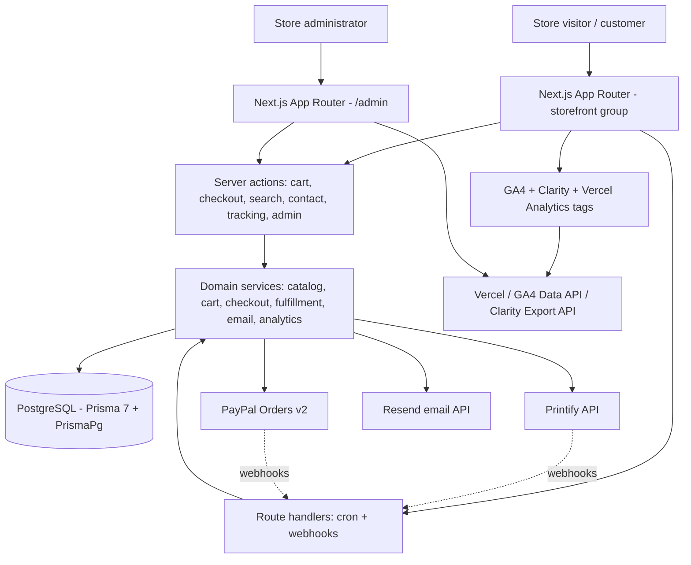
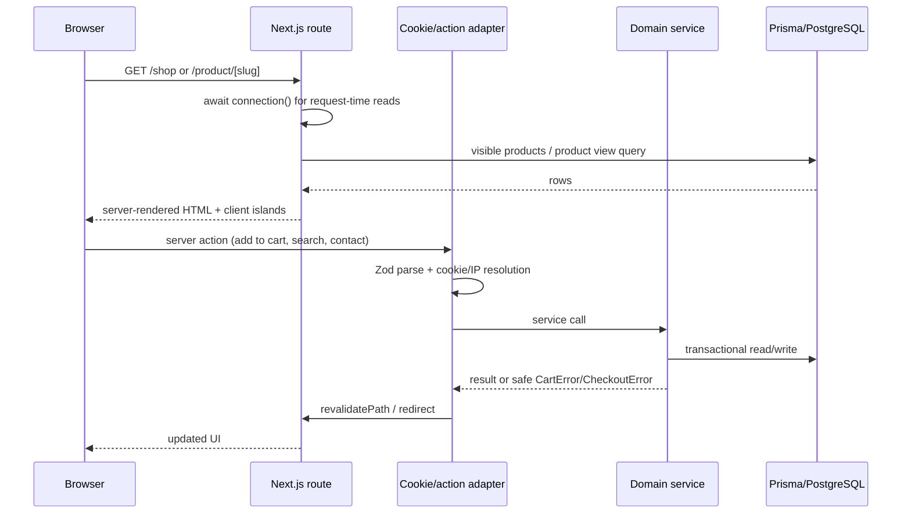
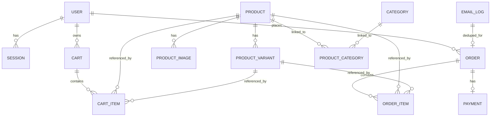

# PROJECT_DOCUMENTATION.md — Zitsy

> **Purpose of this file.** This is a read-only, evidence-based technical reference for an AI tool or developer that has never seen the repository. It describes what Zitsy actually is, how the code is organised, which features are genuinely implemented, and what remains incomplete. Every substantial claim points to a repository-relative source path.
>
> **Audit scope and constraints.** This document was produced from static repository inspection only. No application was started, no browser/Playwright session was run, no account was created, no database was changed, no migration was run, no environment value was read or printed, and no test/lint/typecheck/build command was executed. The repository had uncommitted work at audit time (modified analytics, checkout, header and documentation files plus new untracked files); that work was preserved and is reflected where relevant. Historical verification numbers quoted from existing docs are labelled **REPORTED**, not independently verified here.
>
> **Evidence legend:** **CONFIRMED** = directly observed in source during this audit. **REPORTED** = stated in existing repository documentation but not re-verified here. **POTENTIAL** = inferred concern requiring investigation. Status words used in feature tables follow the definitions in §9.

---

## 1. Executive Summary

Zitsy is a **print-on-demand e-commerce storefront** built as a single Next.js application. It sells real catalogue products synced from Printify, takes payment through PayPal, creates fulfillment orders in Printify, sends transactional email through Resend, and exposes a private analytics dashboard protected by environment-configured admin credentials. It is a code-complete vertical commerce system rather than a demo shell: order state is authoritative in PostgreSQL, external webhooks are signature-verified and idempotent, and the browser is never trusted for prices or payment success.

The application is **production-oriented in design but not deployed or live-verified from this repository**. The canonical production origin is documented as `https://zitsy.darkhub.dev` (`README.md:37-50`), but local environment values were not inspected. Existing documentation calls the project "READY WITH REQUIRED PRE-LAUNCH ACTIONS" (`docs/ARCHITECTURE.md:334-355`), with the remaining blockers being environment credentials and provider configuration, not known code defects.

Key engineering characteristics:

- **One full-stack Next.js 16 App Router application** with React 19, TypeScript strict mode, Tailwind CSS v4, Prisma 7 over PostgreSQL, and Zod validation (`package.json:19-49`).
- **Server-authoritative money flow:** integer minor units, GBP-only storefront, explicit USD→GBP FX configuration, server-side shipping quotes and server-side profitability gating (`src/lib/pricing.ts`, `src/lib/shipping.ts`, `src/lib/checkout/profitability.ts`).
- **Two independent state machines:** payment (`PENDING → PAYMENT_PENDING → PAID`, plus failure/cancel) and fulfillment (`PENDING → SUBMITTED → … → FULFILLED`, plus problem states). Fulfillment never rewrites payment state (`prisma/schema.prisma:150-182`, `src/lib/fulfillment/status.ts`).
- **Idempotency everywhere external:** unique webhook-event ledger, stable PayPal capture request IDs, Printify `external_id` reconciliation, and a unique email dedupe key backed by `EmailLog` (`prisma/schema.prisma:298-342`).
- **Consent-gated analytics:** GA4 and Clarity tags are injected dynamically only after explicit consent; Vercel Web Analytics is mounted only after consent and filters private routes (`src/lib/analytics/client.ts`, `src/components/analytics/analytics.tsx`).
- **No customer accounts, no wishlist, no admin CRUD screens.** The User/Session models exist in the schema but are unused by runtime flows (`prisma/schema.prisma:10-33`, `docs/ARCHITECTURE.md:94`). Admin consists of a redirect, a login page, and a single analytics page (`src/app/admin/**`).

For portfolio purposes, the strongest story is **"a complete, privacy-conscious print-on-demand commerce pipeline with real payment/fulfillment idempotency and honest, consent-aware analytics"** — not "a marketplace" or "a multi-tenant SaaS."

---

## 2. Project Identity and Purpose

### 2.1 Non-technical description

Zitsy is an online store for graphic apparel and lifestyle goods. Products are made only when ordered by a print-on-demand provider, so the store does not hold its own stock. A customer browses the catalogue, picks a variant such as size and colour, pays with PayPal, and receives email updates with a tracking link. The store owner has a private dashboard that shows sales figures from the database alongside behavioural analytics from separate providers.

Tagline: **"Easy as Zitsy."** (`docs/ARCHITECTURE.md:3`, `src/lib/config/public-env.ts:15-19`)

### 2.2 Technical description

Zitsy is a single Next.js App Router application that serves both the public storefront and the private admin area. A local PostgreSQL database is the read model for a Printify catalogue and the source of truth for carts, orders, payments, webhook events, email attempts and rate-limit state. Printify is integrated in two directions: a catalog sync (CLI + scheduled cron) and fulfillment order creation/status webhooks. PayPal Orders v2 is integrated through a server-side client and verified webhooks. Email is delivered through the Resend SDK with React Email templates. Analytics uses browser-side GA4/Clarity/Vercel tags gated by a consent cookie, plus server-only read APIs surfaced in `/admin/analytics`.

### 2.3 Portfolio-ready description

> Zitsy is a full-stack print-on-demand storefront built with Next.js 16, React 19, TypeScript, Prisma and PostgreSQL. It synchronises a real Printify catalogue, resolves product variants and images, implements a guest cart and PayPal checkout with server-side capture verification, creates Printify fulfillment orders idempotently, sends transactional email with Resend, and provides a credential-protected analytics dashboard that keeps sales data separate from consent-gated behavioural analytics.

### 2.4 Problem solved and target users

| Concern | Evidence |
|---|---|
| Selling made-to-order products without holding inventory; Printify is the fulfillment source. | `docs/ARCHITECTURE.md:6-28`, `src/lib/catalog/sync.ts`, `src/lib/fulfillment/service.ts` |
| Avoiding fake/stale prices: retail prices are derived from real Printify fulfillment cost with configured FX and markup. | `src/lib/pricing.ts:44-69`, `src/lib/fx.ts:30-63` |
| Preventing double charges, duplicate fulfillment orders and duplicate emails. | `src/lib/checkout/service.ts:624-717`, `src/lib/fulfillment/service.ts:78-250`, `src/lib/email/service.ts:74-205` |
| Letting customers check order status without creating an account. | `src/lib/orders/tracking.ts`, `src/app/(storefront)/track-order/[token]/page.tsx` |
| Keeping private routes and search terms out of analytics. | `src/lib/analytics/client.ts:30-43,150-184`, `src/lib/analytics/url.ts`, `src/lib/search/actions.ts`, `src/proxy.ts` |

Target users: **store visitors/customers** (guest checkout, no login) and a **single store administrator** (env-configured shared credential). There is no multi-user admin model and no customer account surface (`src/lib/admin/session.ts`, `docs/ARCHITECTURE.md:94,150`).

---

## 3. Problem Statement and Use Cases

Primary user journeys visible in the code:

1. **Browse and discover** — home, shop (category/sort), product detail, in-memory search, static info pages (`src/app/(storefront)/**`).
2. **Configure a product** — size/colour options are derived only from enabled, available, costed Printify variants; images are grouped by colour and filtered by variant (`src/lib/catalog/variants.ts`, `src/lib/catalog/gallery.ts`, `src/components/storefront/product-view.tsx`).
3. **Cart with server authority** — a random cookie token (only its SHA-256 hash is stored) identifies the cart; the server re-validates everything and stores DB prices (`src/lib/cart/session.ts`, `src/lib/cart/service.ts`).
4. **Checkout and payment** — server snapshots the cart, quotes shipping, checks profitability, creates a PayPal order, then verifies capture amount/currency/reference before marking `PAID` (`src/lib/checkout/service.ts`).
5. **Fulfillment and tracking** — idempotent Printify order creation, webhook-driven status/tracking updates, login-free tracking links (`src/lib/fulfillment/**`, `src/lib/orders/tracking.ts`).
6. **Support** — contact form with honeypot, per-IP limit, and store/customer emails (`src/lib/contact/**`).
7. **Admin analytics** — database sales totals plus independent Vercel/GA4/Clarity cards with per-provider setup/error states and rate-limited refresh (`src/app/admin/analytics/page.tsx`, `src/lib/analytics/providers/**`).

Explicitly **not** implemented: customer registration/login, wishlist, coupons, tax/VAT calculation, refunds/cancellations in the UI, admin product/order/customer management screens, email queue/worker, multi-currency checkout (`docs/ARCHITECTURE.md:253-258,271-277,358`).

---

## 4. Project Status

| Dimension | Status | Evidence / caveat |
|---|---|---|
| Application code | **CONFIRMED present and broad** | 19 storefront/admin page files, 4 API routes, ~90 library modules, 20 UI components. |
| Commerce pipeline | **IMPLEMENTED in code** | Cart → checkout → PayPal → fulfillment → email → tracking chain is wired (`src/lib/checkout/service.ts`, `src/lib/fulfillment/service.ts`, `src/lib/email/order-notifications.ts`). |
| Live third-party verification | **PARTIAL / REPORTED** | Architecture log records live Printify order creation and browser PayPal SDK checks, but explicitly states real PayPal Sandbox capture and live Resend delivery were not exercised (`docs/ARCHITECTURE.md:224-226,237,271,277`). Not re-verified here. |
| Browser/visual verification | **NOT PERFORMED in this audit** | Per the clarified read-only scope, no browser or Playwright session was run. An `audit/before-home-desktop.png` screenshot exists but was not inspected. |
| Test suite | **PRESENT, NOT EXECUTED here** | 48 Vitest `*.test.ts` files and 5 Playwright specs observed; no coverage script configured. Historical totals in docs vary (402/422/437) and are **REPORTED** only. |
| Deployment | **CONFIGURED, not verified** | `vercel.json`, `.vercel/`, `docs/DEPLOYMENT.md` exist; no deployment or production check was performed. |
| Worktree | **Dirty (preserved)** | Modified: `docs/DEPLOYMENT.md`, analytics/client/provider files, `src/app/admin/analytics/page.tsx`, `src/components/checkout/checkout-form.tsx`, `src/components/storefront/header.tsx`, `tsconfig.json`, `tests/analytics-clarity.test.ts`. Untracked: `audit/before-home-desktop.png`, `opencode.json`, `src/lib/checkout/quote-key.ts`, `tests/checkout-quote-key.test.ts`. |
| Phase plan | **Phases 1–9 logged as done; 10–11 remain** | `docs/ARCHITECTURE.md:170-172,174-358`. Phase 10 polish and Phase 11 final verification are listed as next. |

Overall stage: **late-stage MVP / pre-launch production candidate**, based on the phase log, deployment runbook, and the explicit pre-launch action list (`docs/ARCHITECTURE.md:334-355`, `docs/DEPLOYMENT.md:1-6`). Do not describe it as "fully production-ready", "enterprise-grade", or "scalable" without qualification: the same docs list required credential work, proxy-header verification and known trade-offs.

---

## 5. Technology Stack

### 5.1 Direct dependencies (from `package.json:19-49`)

| Category | Technology | Where / why |
|---|---|---|
| Language | TypeScript 5 (strict, `noEmit`) | `tsconfig.json:11-14`; all application code. |
| Runtime | Node.js `>=22.13.0 <23`, pinned `22.23.1` | `package.json:5-7`, `.nvmrc`, `.node-version`. |
| Package manager | pnpm `11.5.2` | `package.json:50`, `pnpm-lock.yaml`. |
| Frontend | Next.js `16.4.3` (App Router, Turbopack dev), React `19.2.8` | `src/app/**`, `package.json:26-28`. Server components + server actions are the main data path. |
| Styling | Tailwind CSS v4 (`@tailwindcss/postcss`), `clsx`, `tailwind-merge` | `src/app/globals.css:1-144`, `postcss.config.mjs`, `src/lib/utils.ts`. |
| Fonts | Geist, Geist Mono, Fraunces via `next/font/google` | `src/app/layout.tsx:8-24`. |
| Database | PostgreSQL | `prisma/schema.prisma:6-8`; local `zitsy_store`, test `zitsy_store_test` (`tests/test-db.ts`). |
| ORM | Prisma `7.10.1` (`@prisma/client`, `@prisma/adapter-pg`, `prisma-client` generator) | `prisma/schema.prisma:1-4`, `prisma.config.ts`, `src/lib/db/prisma.ts`. |
| Validation | Zod `4` | Server/action schemas across `src/lib/{cart,checkout,contact,config,search}/**`. |
| Payments | PayPal Orders v2 REST (custom client, not an SDK) | `src/lib/paypal/client.ts`, browser JS SDK loaded in `src/components/checkout/checkout-form.tsx`. |
| Fulfillment | Printify Public API v1 (custom fetch client) | `src/lib/printify/client.ts`. |
| Email | `resend` SDK + `@react-email/render` | `src/lib/email/client.ts`, `src/lib/email/render.ts`, templates in `src/lib/email/templates/`. |
| Analytics client | `@vercel/analytics` | `src/components/analytics/analytics.tsx:20-23,152-154`; mounted only after consent. |
| Env loading | `dotenv` | Test/E2E configs load `.env` before overriding test values. |
| Scripting | `tsx` | `pnpm printify:sync` → `scripts/printify-sync.ts`. |
| Unit/integration tests | Vitest `5` + `@vitest/coverage-v8` | `vitest.config.ts`, `tests/**`. |
| E2E tests | Playwright `1.63` + `@playwright/test` | `playwright.config.ts`, `e2e/**`. `opencode.json` also enables a Playwright MCP server. |
| Lint | ESLint `9` + `eslint-config-next` | `eslint.config.mjs`, `pnpm lint`. |
| Infrastructure | Vercel (cron + deployment metadata) | `vercel.json`, `.vercel/`, `docs/DEPLOYMENT.md`. |

### 5.2 Notable transitive / indirect technologies

`lodash` and `fast-uri` are mentioned as transitive packages updated for the dependency audit, and `vite` is pinned directly to avoid a vulnerable optional peer used by Vitest (`docs/DEPLOYMENT.md:387-392`, `docs/ARCHITECTURE.md:285`). No runtime use of these packages by application code was found. There is no Redis, message queue, separate worker process, CMS, or external auth provider in the dependency list.

### 5.3 Architectural choices visible in code

- **No client state-management library.** React local state, `useSyncExternalStore` (consent), server actions and `revalidatePath`/`revalidateTag` cover state needs (`src/components/analytics/analytics.tsx:110-119`, `src/lib/cart/actions.ts`, `src/lib/analytics/providers/actions.ts`).
- **No component library install.** There is no `src/components/ui/` directory. Reusable markup is hand-written (`globals.css` classes such as `.btn-primary`, `.chip`, `.container-page`, plus local components like `ProductCard` and `InfoPage`). `docs/ARCHITECTURE.md:38` calls them "shadcn-style primitives"; that is a style description, not a dependency.
- **Money as integers** (`*Minor`) with explicit conversion/formatting helpers (`src/lib/money.ts`).

---

## 6. System Architecture

### 6.1 High-level architecture



### 6.2 Layers and responsibilities

| Layer | Key paths | Responsibility |
|---|---|---|
| Route/presentation | `src/app/(storefront)/**`, `src/app/admin/**`, `src/components/**` | Server-rendered pages, client islands, forms, metadata, error/loading/not-found states. |
| Entry adapters | `src/lib/**/actions.ts`, `src/app/api/**/route.ts`, `src/proxy.ts` | Server-action boundary and HTTP/webhook/cron boundary; Zod validation and auth checks here. |
| Domain services | `src/lib/{catalog,cart,checkout,fulfillment,orders,email,contact,search,analytics,admin}/**` | Business rules, state transitions, orchestration, projections. |
| External I/O | `src/lib/{printify,paypal}/client.ts`, `src/lib/email/client.ts`, `src/lib/analytics/providers/**` | Provider HTTP calls; injected gateway types allow deterministic tests. |
| Data/config | `src/lib/db/prisma.ts`, `prisma/schema.prisma`, `src/lib/config/env.ts`, `src/lib/config/public-env.ts` | Persistence, server/public config separation. |
| Cross-cutting | `src/lib/log.ts`, `src/lib/http.ts`, `src/lib/rate-limit.ts`, `src/lib/admin/*rate-limit*.ts`, `src/lib/cron/auth.ts` | Redacted logging, client IP, rate limits, cron bearer auth. |

Responsibility rule documented in `docs/ARCHITECTURE.md:86-90`: external I/O modules contain no business rules; `src/lib/checkout/service.ts` is the orchestration point; state machines are pure functions; secrets are read only in `src/lib/config/env.ts`.

### 6.3 Request lifecycle (typical storefront page)



`await connection()` is used where request-time data is required because `force-dynamic` is ignored in this Next.js version (`docs/ARCHITECTURE.md:198`); examples: `src/app/admin/analytics/page.tsx:114`, `src/app/(storefront)/checkout/page.tsx:16`, `src/app/(storefront)/page.tsx:42`.

### 6.4 External-service communication

- **Outbound** fetch clients with timeouts and typed errors: Printify 30 s (`src/lib/printify/client.ts:68-126`), PayPal OAuth/capture (`src/lib/paypal/client.ts:52-213`), Resend via SDK (`src/lib/email/client.ts:32-59`), provider reporting APIs (`src/lib/analytics/providers/http.ts`, `vercel.ts`, `ga4.ts`, `clarity.ts`).
- **Inbound** signed webhooks: PayPal verifies via PayPal's own verification API; Printify verifies `X-Pfy-Signature` HMAC-SHA256 over the raw body with `timingSafeEqual` (`src/lib/printify/webhooks.ts:16-45`, `src/app/api/webhooks/paypal/route.ts`, `src/app/api/webhooks/printify/route.ts`).
- **Scheduled** Vercel cron calls two bearer-protected routes daily (`vercel.json:3-12`, `src/app/api/cron/**`).
- **No queue/worker.** Sends are inline best-effort; retries come from webhook redelivery or the narrow fulfillment cron (`docs/ARCHITECTURE.md:275`, `src/app/api/cron/fulfillment-retry/route.ts`).

---

## 7. Repository Structure

```text
zitsy/
├── package.json, pnpm-lock.yaml, pnpm-workspace.yaml
├── next.config.ts, tsconfig.json, postcss.config.mjs, eslint.config.mjs
├── playwright.config.ts, vitest.config.ts, vercel.json, prisma.config.ts
├── .env.example                 # committed template; real .env files are gitignored
├── .nvmrc, .node-version        # Node 22.23.1
├── README.md, AGENTS.md, CLAUDE.md
├── docs/
│   ├── ARCHITECTURE.md          # stack, data model, state machines, phase log
│   └── DEPLOYMENT.md            # environment, migrations, smoke tests, rollback
├── prisma/
│   ├── schema.prisma            # 16 models, 3 enums
│   └── migrations/              # 8 ordered migrations
├── scripts/
│   ├── printify-sync.ts         # pnpm printify:sync
│   └── generate-brand-assets.py
├── src/
│   ├── app/
│   │   ├── (storefront)/        # public routes
│   │   ├── admin/               # /admin redirect, /admin/login, /admin/analytics
│   │   ├── api/cron/**, api/webhooks/**
│   │   ├── globals.css, layout.tsx, error.tsx, global-error.tsx, not-found.tsx
│   │   └── robots.ts, sitemap.ts, icon.png, apple-icon.png
│   ├── components/
│   │   ├── analytics/, admin/, checkout/, storefront/, brand/
│   ├── lib/                     # domain modules (see §8)
│   ├── generated/prisma/        # generated client, gitignored
│   └── proxy.ts                 # legacy /search?q redirect
├── tests/                       # 48 Vitest suites + fakes/setup
├── e2e/                         # 5 Playwright specs + seed + Resend stub
├── public/                      # og.png, favicon, verification file
├── audit/                       # existing screenshot artifact (not inspected)
├── graphify-out/                # generated knowledge graph output
├── zitsy-marketing/             # gitignored local marketing workspace
└── Product/, zysy-marketing/    # mostly empty/unused local directories
```

Root-level brand/SEO/UI reports (`UI-UX-REPORT.md`, `UI-UX-ROUND-2-REPORT.md`, `UI-UX-ROUND-3-REPORT.md`, `SEO-AUDIT-UK-DE.md`, `BRAND-SEO-MARKETING-READINESS.md`, `ZITSY-BRAND-SEO-RESUME-STATUS.md`, `CONTENT-GUIDELINES.md`) are historical audit snapshots. Some contain stale statements (for example "no analytics, no consent tooling") that are contradicted by later code and by `docs/ARCHITECTURE.md:289-332`. Treat `docs/ARCHITECTURE.md` as the newer implementation narrative, but verify against source as done here.

---

## 8. Core Modules and Responsibilities

| Module | Files | Responsibility |
|---|---|---|
| Config | `src/lib/config/env.ts`, `public-env.ts` | Zod-validated server env with fail-closed parsing; explicitly separate browser-safe values; integration capability flags. |
| DB | `src/lib/db/prisma.ts` | `PrismaPg` adapter and singleton client. |
| Catalog | `src/lib/catalog/{sync,query,view,variants,gallery,categories,tags,search,slug,description}.ts` | Printify read model, variant resolution, gallery grouping, deterministic categories, in-memory search. |
| Cart | `src/lib/cart/{session,service,view,read,actions,schemas,errors}.ts` | Hashed guest-token cookie, server-authoritative mutations, pure view projection. |
| Checkout | `src/lib/checkout/{service,actions,schemas,session,profitability,paypal-buttons,quote-key,errors}.ts` | Snapshot/quote/begin/capture, signed order cookie, profitability guard, PayPal SDK callback contract. |
| PayPal | `src/lib/paypal/{client,config,types,webhook-handler}.ts` | OAuth/capture/get/webhook verification, injectable gateway, event dedupe and dispatch. |
| Fulfillment | `src/lib/fulfillment/{service,status,address,errors,shipping-reconciliation}.ts` | Idempotent Printify order creation, forward-only status merge, ambiguity reconciliation, shipping quote-vs-billed observability. |
| Orders | `src/lib/orders/{state,order-number,tracking,tracking-actions}.ts` | State helpers, `ZS-XXXXXXXX` numbers, tracking tokens and rate-limited lookup. |
| Email | `src/lib/email/{config,client,service,render,types,errors,order-notifications}.ts`, `src/lib/email/templates/**` | Dedupe ledger, Resend send path, seven templates, best-effort notification triggers. |
| Contact | `src/lib/contact/{schemas,service,actions}.ts` | Honeypot, per-IP limit, sanitisation, store + customer messages. |
| Analytics client | `src/lib/analytics/{client,consent,events,url,purchase}.ts`, `src/components/analytics/**` | Consent cookie, GA4/Clarity injection, route suppression, URL sanitisation, purchase eligibility/dedupe. |
| Analytics reporting | `src/lib/analytics/providers/{config,server,vercel,ga4,clarity,http,range,actions,types}.ts`, `src/lib/admin/analytics.ts` | Server-only provider credentials, cached reports, diagnostics, DB sales totals, refresh action. |
| Admin | `src/lib/admin/{guard,session,actions,analytics,*rate-limit}.ts` | Credential check, HMAC session bound to credentials, durable login/refresh limits, page guard. |
| Cross-cutting | `src/lib/{log,http,money,utils,rate-limit,cron/auth,metadata,markets,fx,pricing,shipping}.ts` | Logging/IP/money/FX/pricing/shipping/metadata utilities. |

---

## 9. Features and Implementation Status

Status definitions: **IMPLEMENTED** = verified working implementation in code (tests and/or execution paths inspected); **PARTIALLY IMPLEMENTED** = meaningful code with important gaps; **CONFIGURED** = configuration exists but operation not verified here; **EXPERIMENTAL** = present but insufficiently validated; **PLANNED** = explicitly documented as planned; **UNKNOWN** = insufficient evidence.

| Feature | Status | Implementation / notes |
|---|---|---|
| Printify catalogue sync (CLI + cron) | IMPLEMENTED | `src/lib/catalog/sync.ts`, `scripts/printify-sync.ts`, `src/app/api/cron/catalog-sync/route.ts`; overlap guard and stable variant IDs. |
| Storefront browse, categories, product detail, variants/gallery | IMPLEMENTED | `src/app/(storefront)/**`, `src/lib/catalog/**`, `src/components/storefront/product-view.tsx`. |
| Privacy-preserving search | IMPLEMENTED | Server action + HttpOnly `/search` cookie; legacy `?q=` redirected in `src/proxy.ts`; analytics sends only result count. |
| Guest cart with price/availability revalidation | IMPLEMENTED | `src/lib/cart/**`; only token hash stored; no cart created on read. |
| Checkout quote + shipping + profitability guard | IMPLEMENTED | `src/lib/checkout/service.ts:222-327`, `src/lib/shipping.ts`, `src/lib/checkout/profitability.ts`. |
| PayPal order creation, browser approval, server capture verification | IMPLEMENTED in code; live Sandbox unverified | `src/lib/checkout/service.ts:624-717`, `src/lib/checkout/paypal-buttons.ts`; docs explicitly note real Sandbox capture not run (`docs/ARCHITECTURE.md:224-226`). |
| PayPal webhooks (approve/capture/deny, dedupe) | IMPLEMENTED | `src/lib/paypal/webhook-handler.ts`, `src/app/api/webhooks/paypal/route.ts`. |
| Printify order creation, production send, status webhooks | IMPLEMENTED in code; live API REPORTED | `src/lib/fulfillment/service.ts`, `src/lib/printify/handlers.ts`; docs record one live order (`docs/ARCHITECTURE.md:237`). Auto-send defaults false. |
| Fulfillment retry cron | IMPLEMENTED | `src/app/api/cron/fulfillment-retry/route.ts`, bounded to paid/unsubmitted/transient errors, batch 20, `<10` attempts. |
| Shipping quote-vs-actual reconciliation | IMPLEMENTED (observability only) | `src/lib/fulfillment/shipping-reconciliation.ts`; never changes customer or payment state. |
| Transactional email (7 templates) + dedupe | IMPLEMENTED in code; live Resend unverified | `src/lib/email/**`; delivery tested against local stub only (`docs/ARCHITECTURE.md:271,277`). |
| Login-free order tracking | IMPLEMENTED | `src/lib/orders/tracking.ts`, `src/app/(storefront)/track-order/**`, rate-limited lookup. |
| Contact form | IMPLEMENTED | `src/lib/contact/**`, `src/components/storefront/contact-form.tsx`. |
| Consent banner + GA4/Clarity/Vercel tags | IMPLEMENTED in code; browser behaviour not re-verified here | `src/components/analytics/analytics.tsx`, `src/lib/analytics/client.ts`, `src/lib/analytics/consent.ts`. |
| Admin analytics (DB totals + 3 provider cards + refresh) | IMPLEMENTED | `src/app/admin/analytics/page.tsx`, `src/lib/admin/analytics.ts`, `src/lib/analytics/providers/**`. |
| Admin login/session | IMPLEMENTED | `src/lib/admin/{session,actions,guard}.ts`; single env credential pair, no DB admin user. |
| Customer accounts / registration / login | NOT IMPLEMENTED (out of scope) | User/Session models exist but are unused (`prisma/schema.prisma:10-33`, `docs/ARCHITECTURE.md:94,358`). |
| Wishlist | NOT IMPLEMENTED | No route, component, cookie or reference found in `src/**`. |
| Coupons, tax engine, refunds/cancellations UI | NOT IMPLEMENTED | Documented limitations (`docs/ARCHITECTURE.md:253-258`, `docs/DEPLOYMENT.md:339-392`). |
| Admin product/order/customer/coupon/settings CRUD | NOT IMPLEMENTED | Only `/admin`, `/admin/login`, `/admin/analytics` exist (`src/app/admin/**`). |
| Email queue / retry worker | NOT IMPLEMENTED | Inline best-effort sends; `EmailLog` records failures (`docs/ARCHITECTURE.md:275`). |
| Phase 10 polish / Phase 11 final verification | PLANNED | `docs/ARCHITECTURE.md:357-358`. |

---

## 10. Application Workflows

### 10.1 Customer purchase flow

```mermaid
sequenceDiagram
    participant C as Customer browser
    participant A as Next.js actions
    participant S as Checkout/fulfillment services
    participant DB as PostgreSQL
    participant P as PayPal
    participant PF as Printify
    participant E as Resend

    C->>A: addToCart(productId, variantId, quantity)
    A->>DB: validate variant/product; store DB price
    C->>A: beginCheckoutAction(customer)
    A->>S: quote + profitability + revalidation
    S->>PF: shipping quote (standard)
    S->>DB: create Order(PAYMENT_PENDING) + Payment(PENDING)
    S->>P: createOrder(intent=CAPTURE, custom_id=order.id)
    P-->>S: PayPal order id
    S->>DB: store paypalOrderId; set signed zitsy_order cookie
    C->>P: approve in PayPal JS SDK
    C->>A: captureCheckoutAction()
    A->>S: captureOrderPayment with PayPal-Request-Id
    S->>P: capture + getOrder, verify id/amount/currency
    S->>DB: Payment COMPLETED; Order PAID; clear cart items
    S->>E: notifyOrderPaid (best effort, deduped)
    S->>PF: fulfillPaidOrder -> create Printify order (idempotent)
    PF-->>S: order/fulfillment webhooks
    S->>DB: forward-only fulfillment status + tracking
    S->>E: submitted/shipped/delivered notices (deduped)
```

Key guardrails: amount/currency/reference mismatch marks `PAYMENT_FAILED` and never `PAID`; the `PAYMENT_PENDING` order is reused only when the full contact and address match (`src/lib/checkout/service.ts:378-412,553-569,624-717`).

### 10.2 Catalog sync flow

1. `pnpm printify:sync` or `GET /api/cron/catalog-sync` (bearer) calls `syncCatalog()`.
2. `getAllProducts()` walks paginated Printify results (`src/lib/printify/client.ts:128-150`).
3. Each product is upserted in a transaction: images replaced, variants upserted by `(productId, printifyVariantId)`, categories rebuilt, missing variants disabled, prices derived from cost via FX/markup (`src/lib/catalog/sync.ts:52-180`).
4. Products absent from Printify are hidden, not deleted; a `CatalogSyncRun` row records status/counters; a 30-minute overlap guard prevents colliding runs (`src/lib/catalog/sync.ts:187-275`).

### 10.3 Admin analytics flow

1. `requireAdminPage()` checks the signed `zitsy_admin` cookie and redirects to `/admin/login` on failure (`src/lib/admin/guard.ts`, `src/lib/admin/session.ts`).
2. `loadAdminAnalytics()` aggregates paid, non-cancelled orders from PostgreSQL: totals, status/payment breakdowns, 14-day UTC trend, top products, recent paid orders (`src/lib/admin/analytics.ts`).
3. `loadAnalyticsProviders(range)` reads server-only credentials, then calls cached Vercel/GA4/Clarity report functions in parallel; missing config yields a `not_configured` card instead of an error (`src/lib/analytics/providers/server.ts`).
4. The admin can refresh one provider; `refreshAnalyticsProviderAction` re-checks the session, applies a durable per-provider limit, revalidates only that provider's tag, and redirects with a status notice (`src/lib/analytics/providers/actions.ts`, `src/app/admin/analytics/page.tsx:39-79`).

---

## 11. Database and Data Models

### 11.1 Technology and lifecycle

PostgreSQL with Prisma 7 (`prisma-client` generator output `src/generated/prisma`, `PrismaPg` driver adapter). Schema: `prisma/schema.prisma`; 8 ordered migrations under `prisma/migrations/` (`20261006204811_init` through `20261026121000_admin_analytics_indexes`). Test tooling runs `prisma migrate deploy` against a separate test database (`tests/global-setup.ts`, `e2e/global-setup.ts`). Production migration policy is deliberately cautious and documented in `docs/DEPLOYMENT.md:150-285` (backup, history inspection, approved plan, optional concurrent-index path). No migration was run during this audit.

### 11.2 Entity relationship overview



`EMAIL_LOG` has no foreign key to `Order`; the dashed-style relationship above represents the logical dedupe key `order-*:<orderId>`, not a database constraint.

### 11.3 Main models and constraints

| Model | Key fields / constraints | Purpose |
|---|---|---|
| `User`, `Session` | `email @unique`, `tokenHash @unique` | Present from the original plan; not used by runtime flows (`prisma/schema.prisma:10-33`). |
| `Product` | `printifyId @unique`, `slug @unique`, `options Json`, `visible`, `minPriceMinor`, `syncedAt` | Printify catalogue read model. |
| `ProductImage` | `@@unique([productId, src])`, `variantIds Int[]`, position, default flag | Variant-filtered gallery. |
| `ProductVariant` | `@@unique([productId, printifyVariantId])`, `priceMinor`, `costMinor`, availability/enabled flags, option values | Stable variant identity across resyncs; pricing source. |
| `Category`, `ProductCategory` | slug unique; composite PK `(productId, categoryId)` | Deterministic tag-derived categories. |
| `Cart`, `CartItem` | `Cart.token @unique` (hash only), `@@unique([cartId, variantId])`, `unitPriceMinor` snapshot | Guest cart. |
| `Order` | `orderNumber @unique`, status/fulfillment enums, totals in minor units, address fields, `paypalOrderId @unique`, `printifyOrderId @unique`, `trackingToken @unique`, `deliveredAt`, fulfillment timestamps/error/attempts, shipping-reconciliation columns | Authoritative sales and fulfillment record. |
| `OrderItem` | Printify ids, title/variant/sku, quantity, unit/total price, `onDelete: Restrict` to product/variant | Immutable line snapshot that survives catalog changes. |
| `Payment` | `orderId @unique`, `@@unique([provider, providerOrderId])`, status, amount/currency | 1:1 payment record. |
| `WebhookEvent` | `@@unique([provider, eventId])`, status, payload, error | Idempotency ledger for PayPal/Printify events. |
| `CatalogSyncRun` | type/status/counters/error | Sync observability and overlap guard. |
| `EmailLog` | `dedupeKey @unique`, kind/status/recipient/subject/error | One accepted send per key; mirrored to Resend `Idempotency-Key`. |
| `RateLimitBucket` | `key @id`, `count`, `resetAt BigInt`, `@@index([resetAt])` | Durable fixed-window limiter for admin login/provider refresh. |

Enums: `OrderStatus`, `PaymentStatus`, `FulfillmentStatus` (`prisma/schema.prisma:150-182`). Note that several `OrderStatus` values (`FULFILLMENT_PENDING`, `IN_PRODUCTION`, `SHIPPED`, `DELIVERED`) are legacy relative to the separate `FulfillmentStatus` machine; runtime fulfillment progress is stored in `Order.fulfillmentStatus` and related columns.

---

## 12. API Documentation

### 12.1 HTTP route handlers

Only four REST route handlers exist (`src/app/api/**`):

| Method | Route | Auth/gate | Behaviour |
|---|---|---|---|
| GET | `/api/cron/catalog-sync` | `Authorization: Bearer $CRON_SECRET`; 503 when unset, 401 on mismatch | Runs `syncCatalog()`; 200 with summary, 500 on failure (`src/app/api/cron/catalog-sync/route.ts`, `src/lib/cron/auth.ts`). |
| GET | `/api/cron/fulfillment-retry` | same | Retries paid, unsubmitted orders with transient `printify_unavailable:*` errors; batch 20, attempts <10; 200 with counts (`src/app/api/cron/fulfillment-retry/route.ts`). |
| POST | `/api/webhooks/paypal` | Webhook configured (else 503) + PayPal signature verification (401 on failure), 400 on bad JSON/headers, 500 on processing failure | Dispatches `CHECKOUT.ORDER.APPROVED`, `PAYMENT.CAPTURE.COMPLETED`, `PAYMENT.CAPTURE.DENIED`; deduped by `WebhookEvent` (`src/lib/paypal/webhook-handler.ts`). |
| POST | `/api/webhooks/printify` | `PRINTIFY_WEBHOOK_SECRET` (else 503) + HMAC verification (401), 400 on bad JSON, 500 on failure, else 200 | Product events upsert/hide catalog; order events update fulfillment (`src/lib/printify/handlers.ts`). |

`/robots.txt` and `/sitemap.xml` are generated by `src/app/robots.ts` and `src/app/sitemap.ts`. `src/proxy.ts` intercepts only `/search` to redirect legacy `?q=` URLs.

### 12.2 Server actions (main internal mutations)

| Action module | Exported actions |
|---|---|
| `src/lib/cart/actions.ts` | `addToCart`, `updateCartItem`, `removeCartItem`, `clearCartAction` |
| `src/lib/checkout/actions.ts` | `beginCheckoutAction`, `quoteCheckoutAction`, `captureCheckoutAction` |
| `src/lib/search/actions.ts` | `searchAction`, `clearSearchAction` |
| `src/lib/contact/actions.ts` | `submitContactAction` |
| `src/lib/orders/tracking-actions.ts` | `lookupOrderAction` |
| `src/lib/admin/actions.ts` | `adminLoginAction`, `adminLogoutAction` |
| `src/lib/analytics/providers/actions.ts` | `refreshAnalyticsProviderAction` |

All of these parse/validate inputs and return safe messages or redirect; server-side price/total authority is never delegated to the client (`src/lib/cart/service.ts`, `src/lib/checkout/service.ts`).

---

## 13. External Integrations

| Service | Purpose | Integration | Auth mechanism (no values) | Data / failure handling |
|---|---|---|---|---|
| **Printify** | Catalog source + fulfillment | Custom REST client, catalog sync, webhooks, order creation, shipping quotes (`src/lib/printify/**`, `src/lib/catalog/sync.ts`, `src/lib/fulfillment/**`) | Server-only Bearer token; webhook HMAC `X-Pfy-Signature` | Products/variants/images/tags/costs, shipping rates, orders and statuses. 30 s timeout, typed errors, idempotent upserts, forward-only status, ambiguity reconciliation, auto-send disabled by default. |
| **PayPal** | Only payment provider | Orders v2 REST + browser JS SDK (`src/lib/paypal/**`, `src/components/checkout/checkout-form.tsx`) | OAuth2 client credentials (server), verified webhook ID | Order create/capture/get, webhook events; stable `PayPal-Request-Id`, reference/amount/currency verification, error classification. |
| **Resend** | Transactional email | Official SDK + React Email templates (`src/lib/email/**`) | API key, `Idempotency-Key` per send | Seven message kinds; `EmailLog` dedupe; best-effort, masked logs, never throws into order flow. |
| **Vercel Analytics** | Behavioural analytics + reporting | `@vercel/analytics/next` mounted after consent; read-only API in admin (`src/components/analytics/analytics.tsx`, `src/lib/analytics/providers/vercel.ts`) | Read-only API token for reporting (server-only) | Consent-gated collection; `beforeSend` drops `/admin`, `/checkout`, `/track-order`; UTM dimensions not requested; totals fall back to daily sums with warning. |
| **Google Analytics 4** | Browser collection + admin reporting | Consent-gated dynamic `gtag.js` injection; Data API reporting (`src/lib/analytics/client.ts:81-109`, `src/lib/analytics/providers/ga4.ts`) | Public measurement ID for collection; service-account JWT for read-only Data API | `send_page_view:false`, anonymized IP, sanitized page URLs, no PII; 403 diagnostics distinguish property access from disabled Data API. |
| **Microsoft Clarity** | Session replay + reporting | Consent-gated tag injection; Data Export API in admin (`src/lib/analytics/client.ts:111-148`, `src/lib/analytics/providers/clarity.ts`) | Public project ID; project-scoped API token | Private-route `stop`/`start`, load-after-private race handling, 3-day window, 10 requests/day, zero-data diagnostics. |
| **Vercel Cron** | Scheduled sync + retry | `vercel.json` calling two bearer-protected routes | Shared `CRON_SECRET` | Daily catalog sync (03:00 UTC) and fulfillment retry (03:15 UTC). |
| **Google Fonts** | Typography | `next/font/google` at build (`src/app/layout.tsx:8-24`) | None | Geist/Geist Mono/Fraunces exposed as CSS variables. |

**GA4 specifics for this repository:** the literal measurement ID from the original brief (`G-93D82JN0SY`) was **not found hardcoded in source**; a repository-wide search of `*.ts`, `*.tsx`, `*.md`, `*.json` found only the dynamic gtag URL in `src/lib/analytics/client.ts:106` and a test fixture string in `tests/analytics-url.test.ts:143`. The code reads `process.env.NEXT_PUBLIC_GA_MEASUREMENT_ID` statically in `src/lib/config/public-env.ts:22`, which is required for Next.js build-time inlining (`docs/ARCHITECTURE.md:302-308`). The environment variable name exists in `.env`, but values were not read, so **the exact configured ID was not verified in this audit**. The implementation does not insert a second copy of the tag, does not use Google Tag Manager, and does not initialize before consent (`src/lib/analytics/client.ts:81-84`, `src/components/analytics/analytics.tsx:130-145`). Live data collection was **not** independently verified.

---

## 14. Security and Reliability

### 14.1 Mechanisms present (CONFIRMED in source unless noted)

- **Server-only secrets:** `src/lib/config/env.ts` throws when imported in a browser and validates an allowlist; `src/lib/config/public-env.ts` exposes only public values. Startup/first-import failure on invalid config (`src/lib/config/env.ts:3-9,154-209`).
- **Redacted logging:** `src/lib/log.ts:3-20` replaces sensitive key names with `[redacted]`; email errors are additionally sanitized and recipients masked (`src/lib/email/service.ts:54-59`, `src/lib/email/errors.ts:29-45`).
- **Admin authorization:** shared env credential pair; HMAC-SHA256 signed cookie bound to `AUTH_SECRET` *and current credentials*; 12-hour expiry; HttpOnly/SameSite=Lax/Secure-in-production; timing-safe comparisons; rotation invalidates sessions (`src/lib/admin/session.ts`). `requireAdminPage()` protects `/admin/analytics` on every request (`src/lib/admin/guard.ts`, `src/app/admin/analytics/page.tsx:115`).
- **Rate limiting:** durable PostgreSQL fixed-window buckets for admin login and analytics refresh (`src/lib/admin/durable-rate-limit.ts`, `login-rate-limit.ts`, `analytics-refresh-rate-limit.ts`); in-memory fixed-window limiter for tracking lookup and contact form (`src/lib/rate-limit.ts`); hashed client identifiers.
- **Webhook verification:** PayPal verification API; Printify HMAC over raw body with `timingSafeEqual`; fail-closed 503 when unconfigured (`src/app/api/webhooks/**`, `src/lib/printify/webhooks.ts`).
- **Cron verification:** shared `verifyCronAuth()` with length-checked `timingSafeEqual`; 503 when no secret (`src/lib/cron/auth.ts`).
- **Input validation:** Zod schemas on cart/checkout/contact/search/tracking/admin inputs; server recomputes prices and shipping (`src/lib/**/schemas.ts`, `src/lib/checkout/service.ts`).
- **Capability-based tracking:** 192-bit random token, never derived from order id/number; generic failure message for all lookup misses; rate limit 10/min/IP (`src/lib/orders/tracking.ts`, `tracking-actions.ts`).
- **Honeypot + sanitisation** on the contact form (`src/lib/contact/**`).
- **Response headers:** baseline security headers on all routes; `private, no-store` and `noindex` for `/admin`, `/checkout/success`, `/track-order/*`; search gets `private, no-store` + `noindex, follow` (`next.config.ts:10-70`). No CSP by design because of PayPal SDK and Printify-hosted imagery.
- **JSON-LD escaping:** `<` escaped to `\u003c` before `dangerouslySetInnerHTML` (`src/app/layout.tsx:89-94`); product page uses similar protection (`docs/ARCHITECTURE.md:342`).
- **Privacy controls:** consent required before analytics; private-route suppression; search term removed from URLs and GA4 page context; Clarity remains disabled until URL masking is configured externally (`src/lib/analytics/**`, `docs/DEPLOYMENT.md:142-145,373-380`).

### 14.2 Reliability patterns

- Idempotent external effects: webhook ledger, PayPal capture request IDs, conditional Printify id claims, email dedupe key.
- Best-effort email never blocks payment, order state, or fulfillment (`src/lib/email/service.ts:119-205`).
- Forward-only fulfillment status merge prevents stale webhooks from regressing state (`src/lib/fulfillment/status.ts:66-79`).
- Ambiguous Printify creates are recorded and reconciled by `external_id` before any retry (`src/lib/fulfillment/service.ts:145-152,252-268`).
- Failure-safe integrations: unconfigured webhooks/crons return 503; PayPal buttons disable cleanly when PayPal is unconfigured (`docs/ARCHITECTURE.md:168`).

### 14.3 Limitations requiring further review

- **POTENTIAL:** Per-IP limits depend on proxy headers (`x-real-ip`, `x-forwarded-for`); Vercel header behaviour is explicitly not independently verified (`src/lib/http.ts:9-25`, `docs/DEPLOYMENT.md:79-86`).
- **CONFIRMED:** Single shared admin credential; no MFA, per-user admin identities, or audit-log UI (`src/lib/admin/session.ts`, `docs/ARCHITECTURE.md:150`).
- **CONFIRMED:** Some rate limits are process-local (`src/lib/rate-limit.ts`), unsuitable for multi-instance without a shared store (`docs/ARCHITECTURE.md:274-275`).
- **CONFIRMED:** Purchase analytics dedupe is per browser storage; no refund event (`src/lib/analytics/purchase.ts`, `docs/DEPLOYMENT.md:381-386`).
- **POTENTIAL:** Webhook events without a provider event ID fall back to `randomUUID()`, so dedupe is not durable for those events (`src/lib/paypal/webhook-handler.ts:125-126`, `src/lib/printify/handlers.ts:60-61`).
- **POTENTIAL:** `beginCheckout()` creates the local order before PayPal creation; a PayPal creation failure can leave a `PAYMENT_PENDING` order until reuse/cancel logic retires it (`src/lib/checkout/service.ts:417-433`).
- **POTENTIAL:** No CSP; documented trade-off because of third-party scripts/images (`next.config.ts:3-9`).
- **REPORTED:** Pre-launch actions remain for real credentials, domain verification, migration review and cron configuration (`docs/ARCHITECTURE.md:345-355`, `docs/DEPLOYMENT.md:30-148`).

---

## 15. Testing and Verification

### 15.1 Test inventory (static inspection only)

- **48** Vitest TypeScript suites matching `tests/*.test.ts`, plus support files `tests/global-setup.ts`, `tests/setup.ts`, `tests/test-db.ts`, and fakes `fake-email.ts`, `fake-printify.ts`, fake PayPal in `tests/fake-paypal.ts`.
- **5** Playwright specs: `e2e/navigation.spec.ts`, `e2e/track-order.spec.ts`, `e2e/email-tracking-link.spec.ts`, `e2e/admin.spec.ts`, `e2e/contact.spec.ts`, plus `seed.ts`, `resend-stub.ts`, global setup/teardown.
- One Python script `tests/test_dry_run_history.py` references an external workspace and is not wired into any package script.

Important test areas: analytics consent/GA4 URL sanitization/Clarity private-route races (`tests/analytics*.test.ts`, `tests/analytics-clarity.test.ts`), admin guard/session/security (`tests/admin-*.test.ts`), checkout/PayPal (`tests/checkout-*.test.ts`, `tests/paypal-webhook.test.ts`), catalog/cart (`tests/catalog-*.test.ts`, `tests/cart-*.test.ts`), fulfillment/shipping/FX/pricing/profitability, email/tracking/contact, and cron routes.

### 15.2 Isolation and fakes

- `vitest.config.ts`: Node environment, alias `@` → `src`, excludes `e2e/**`, `globalSetup` runs `prisma migrate deploy` on the test DB, `setupFiles` redirects `DATABASE_URL`, `fileParallelism: false`, 30 s test / 60 s hook timeouts.
- `tests/setup.ts` replaces the email transport with a fake and mocks `getPrintifyClient()` so tests cannot reach the real Printify API. PayPal behaviour is exercised through `tests/fake-paypal.ts`.
- `playwright.config.ts` overrides `DATABASE_URL`, `RESEND_API_URL` (local stub on port 4599) and e2e-only admin environment credentials before workers/servers start; `reuseExistingServer: false`, single Chromium worker.
- Coverage tooling (`@vitest/coverage-v8`) is installed but there is **no coverage script or `coverage` block** in `vitest.config.ts`; no coverage report exists in the repository at audit time.

### 15.3 Commands available (not executed in this audit)

| Command | Defined in | Purpose |
|---|---|---|
| `pnpm install` | package manager | Install deps; `postinstall` runs `prisma generate`. |
| `pnpm dev` | `scripts.dev` | Start Next.js dev server on port 3000. |
| `pnpm typecheck` | `scripts.typecheck` | `tsc --noEmit` (tsconfig has `incremental: true`, so this may write a build-info file). |
| `pnpm lint` | `scripts.lint` | ESLint. |
| `pnpm test` | `scripts.test` | `vitest run`. |
| `pnpm test:e2e` | `scripts.test:e2e` | `playwright test` (starts its own dev server and test DB). |
| `pnpm build` | `scripts.build` | `prisma generate && next build`. |
| `pnpm start` | `scripts.start` | Serve an existing production build. |
| `pnpm printify:sync` | `scripts.printify:sync` | Manual catalog sync + webhook reconciliation. |

### 15.4 Results — honest statement

**No test, lint, typecheck, build, E2E, coverage or browser command was executed during this read-only audit**, because such commands create or update files (for example `.next/`, `tsconfig.tsbuildinfo`, coverage output, test artifacts) and the scope permitted creating only this document. Therefore this document makes **no claim that the current suite passes**. Existing docs report historically successful runs with inconsistent totals: `402/402 across 43 files` (`docs/ARCHITECTURE.md:287,355`), `422/422 across 46 files` (`:305-308`) and `437/437 across 47 files` (`:330-332`); E2E is reported as `18/18` in those entries, while older root reports cite `11/11`. The current tree has 48 Vitest suites, including newly added uncommitted tests, so none of those historical totals can be assumed current.

---

## 16. Installation and Development Guide

Based on `README.md:7-35`, `docs/DEPLOYMENT.md:8-25`, `package.json`, `.env.example` and `prisma.config.ts`:

```bash
nvm use                       # Node 22.23.1 from .nvmrc
pnpm install                  # postinstall runs prisma generate
cp .env.example .env          # then set AUTH_SECRET etc. locally
pnpm prisma migrate dev       # local development database
pnpm dev                      # http://localhost:3000
```

Verification commands (for a developer who is allowed to write artifacts):

```bash
pnpm typecheck
pnpm lint
pnpm test
pnpm test:e2e
pnpm build
```

Notes:

- The canonical local origin is `http://localhost:3000`; a production build refuses a localhost `NEXT_PUBLIC_APP_URL` (`src/lib/config/env.ts:134-139`, `README.md:37-50`). Historical builds were evaluated with a non-localhost placeholder URL (`docs/ARCHITECTURE.md:203,355`).
- E2E uses `zitsy_store_test` and a local Resend stub; it never touches the development database or real Resend API (`README.md:34-35`, `playwright.config.ts`).
- `AUTH_SECRET` must be generated locally (at least 32 characters). No value is included here.
- Database setup requires a local PostgreSQL instance. No database was started, reset or modified during this documentation audit.
- Webhooks/crons intentionally fail closed when their secrets are absent; a fully functional local PayPal/Printify/email flow requires provider accounts and correctly configured webhook endpoints.

---

## 17. Configuration and Environment Variables

All names below come from `.env.example` and/or `src/lib/config/env.ts`; **no values are included**.

### 17.1 Required

| Name | Purpose | Validation |
|---|---|---|
| `DATABASE_URL` | PostgreSQL connection for the app | Non-empty, `postgres(ql)://` prefix. |
| `AUTH_SECRET` | Signs order/admin cookies and admin session key | ≥32 chars. |
| `NEXT_PUBLIC_APP_URL` | Canonical origin for metadata, sitemap, robots, tracking links | Absolute URL; localhost rejected in production. |
| `STORE_CURRENCY` | Store currency | 3-letter uppercase; project uses GBP. |

### 17.2 Integration and commerce

`PRINTIFY_API_TOKEN`, `PRINTIFY_SHOP_ID`, `PRINTIFY_WEBHOOK_SECRET`, `PRINTIFY_USER_AGENT`, `PRINTIFY_AUTO_SEND_TO_PRODUCTION`, `PRINTIFY_COST_CURRENCY`, `STORE_FX_RATES`, `STORE_MARKUP_PERCENT`, `PAYMENT_FEE_PERCENT`, `PAYMENT_FEE_FIXED_MINOR`, `STORE_MIN_CONTRIBUTION_MINOR`, `STORE_MERCHANT_COST_MINOR`, `PAYPAL_ENVIRONMENT`, `PAYPAL_CLIENT_ID`, `PAYPAL_CLIENT_SECRET`, `PAYPAL_WEBHOOK_ID`, `NEXT_PUBLIC_PAYPAL_CLIENT_ID`, `RESEND_API_KEY`, `EMAIL_FROM`, `SUPPORT_EMAIL`, `RESEND_API_URL` (**test-only** override), `CRON_SECRET`.

Capability flags derived from these are in `src/lib/config/env.ts:219-271`. Printify needs token+shop; PayPal needs client id+secret; webhooks additionally need their secrets/webhook id; email needs key+sender; cron needs `CRON_SECRET`.

### 17.3 Analytics and admin

| Name | Scope | Notes |
|---|---|---|
| `NEXT_PUBLIC_GA_MEASUREMENT_ID` | Browser | GA4 tag; compiled at build; consent-gated. |
| `NEXT_PUBLIC_CLARITY_PROJECT_ID` | Browser | Clarity tag; keep unset until URL masking is verified externally. |
| `VERCEL_ANALYTICS_TOKEN`, `VERCEL_ANALYTICS_PROJECT_ID`, `VERCEL_ANALYTICS_TEAM_ID` | Server | Reporting API for `/admin/analytics`. |
| `GA4_PROPERTY_ID`, `GA4_CLIENT_EMAIL`, `GA4_PRIVATE_KEY` | Server | Read-only GA4 Data API reporting. |
| `CLARITY_API_TOKEN` | Server | Clarity Data Export API; project-scoped. |
| `ADMIN_USERNAME`, `ADMIN_PASSWORD` | Server | Both required to enable admin sign-in; leave unset to keep admin unusable. |

Only `.env.example` is committed; `.env` and `.env.test` are gitignored. `docs/DEPLOYMENT.md:30-148` documents production values and provider prerequisites without exposing secrets.

---

## 18. Deployment and Infrastructure

- **Platform:** Vercel is indicated by `vercel.json`, `.vercel/`, Vercel Analytics integration, and the deployment runbook (`docs/DEPLOYMENT.md`). A deployment being configured is **not** evidence that a deployment was verified.
- **Build:** `pnpm build` = `prisma generate && next build`; `postinstall` also runs `prisma generate` because `src/generated/` is gitignored (`docs/ARCHITECTURE.md:340`).
- **Runtime:** Node 22.x, pnpm 11.5.2, PostgreSQL. Server routes use the Node runtime where required by crypto/webhook verification.
- **Cron:** two daily Vercel cron jobs (`0 3 * * *` catalog sync, `15 3 * * *` fulfillment retry) protected by `CRON_SECRET` (`vercel.json`, `docs/ARCHITECTURE.md:354`).
- **Migrations:** 8 ordered migrations; the runbook requires backup, history/schema inspection and an approved plan before applying them; it warns about non-concurrent index builds and missing `_prisma_migrations` history (`docs/DEPLOYMENT.md:150-285`).
- **Monitoring/observability:** sanitised structured logs, `CatalogSyncRun`, `WebhookEvent`, `EmailLog`, fulfillment error/attempt fields, and admin provider cards. No dedicated APM/error-tracking service is configured.
- **Production limitations:** required pre-launch credentials and domain verification are listed in `docs/ARCHITECTURE.md:345-355`; Vercel proxy IP-header behavior and Clarity URL masking need external verification (`docs/DEPLOYMENT.md:79-86,142-145`).

---

## 19. Known Limitations and Technical Debt

| Item | Class | Evidence / notes |
|---|---|---|
| Search is in-memory substring matching, appropriate only for a small catalogue | CONFIRMED | `src/lib/catalog/search.ts:26-58`. |
| No tax/VAT engine; Printify post-order VAT excluded from profitability | CONFIRMED | `docs/ARCHITECTURE.md:253-258`. |
| GBP-only storefront; GB/DE markets only | CONFIRMED | `src/lib/markets.ts`, `src/lib/config/env.ts`. |
| No customer accounts/wishlist/coupons/refunds/tax/admin CRUD | CONFIRMED | §9 status table. |
| No email queue or retry worker; failures recorded only | CONFIRMED | `src/lib/email/service.ts`, `docs/ARCHITECTURE.md:275`. |
| Some rate limits are process-local | CONFIRMED | `src/lib/rate-limit.ts`, `docs/ARCHITECTURE.md:274-275`. |
| No scheduled pull-sync of Printify order state; webhooks are primary | CONFIRMED | `syncFulfillmentFromPrintify()` has no runtime caller; `docs/ARCHITECTURE.md` relies on webhooks. |
| Legacy `OrderStatus` fulfillment-like values no longer used for fulfillment progress | CONFIRMED | `prisma/schema.prisma:150-182` vs `src/lib/fulfillment/status.ts`. |
| `clearOrderRefCookie()` and some order-transition helpers have no runtime callers | CONFIRMED | `src/lib/checkout/session.ts:59-62`, `src/lib/orders/state.ts`. |
| Documentation drift: contact message length documented as 2000 but code uses 3000; stale "Phase 5" comment in `orders/state.ts` | CONFIRMED | `docs/ARCHITECTURE.md:267`, `src/lib/contact/schemas.ts:29`, `src/lib/orders/state.ts:3-6`. |
| Proxy IP header trust unverified on Vercel | POTENTIAL | `src/lib/http.ts`, `docs/DEPLOYMENT.md:79-86`. |
| Webhook events missing an ID fall back to a random UUID, weakening durable dedupe | POTENTIAL | `src/lib/paypal/webhook-handler.ts:125-126`, `src/lib/printify/handlers.ts:60-61`. |
| `beginCheckout()` may leave an orphan `PAYMENT_PENDING` order if PayPal creation fails | POTENTIAL | `src/lib/checkout/service.ts:417-433`. |
| Analytics purchase dedupe is browser-local; no refund event | CONFIRMED | `src/lib/analytics/purchase.ts`, `docs/DEPLOYMENT.md:381-386`. |
| Live PayPal capture, live Resend delivery, current test suite and browser behaviour not verified in this audit | CONFIRMED (audit scope) | This document's §4 and §15. |
| Root marketing/SEO/UI reports contain stale status claims | REPORTED/CONFIRMED stale | See §7 and test-agent inventory of root docs. |

---

## 20. Portfolio Positioning

### 20.1 How to categorise the project

A **full-stack e-commerce application / commerce platform prototype approaching production readiness**, with emphasis on backend correctness, third-party integration, privacy, and observability. It is not a pure UI demo, not a marketplace, and not a multi-tenant SaaS.

### 20.2 Main technical strengths (evidence-based)

1. **Correctness under retries:** idempotent payments, fulfillment and email using durable unique keys (`prisma/schema.prisma:298-342`, `src/lib/checkout/service.ts:624-717`).
2. **Clear separation of payment and fulfillment state machines** (`src/lib/fulfillment/status.ts`, `src/lib/orders/state.ts`).
3. **Server-authoritative pricing and validation** with real FX/shipping/profitability logic instead of mocked numbers (`src/lib/pricing.ts`, `src/lib/shipping.ts`, `src/lib/checkout/profitability.ts`).
4. **Privacy-by-design analytics:** consent gate, private-route suppression, search-term sanitisation, independent provider cards that never fabricate or sum metrics (`src/lib/analytics/**`, `src/lib/admin/analytics.ts`).
5. **Comprehensive tests for a single-developer project:** 48 Vitest suites and 5 E2E specs with fakes for every external provider (`tests/**`, `e2e/**`).
6. **Operational thinking:** deployment runbook, migration gates, cron cadence trade-offs and explicit pre-launch checklist (`docs/DEPLOYMENT.md`, `docs/ARCHITECTURE.md:334-355`).

### 20.3 Distinctive features worth demonstrating

- Variant-aware gallery and exact variant resolution from real Printify option data, not hardcoded colours/sizes (`src/lib/catalog/variants.ts`, `src/lib/catalog/gallery.ts`).
- Login-free tracking with 192-bit capability tokens and generic lookup failures (`src/lib/orders/tracking.ts`).
- "Database is the sales source of truth; provider analytics may differ" copy and provider cards (`src/app/admin/analytics/page.tsx:139-143,207-211`).
- Explicit handling of ambiguous Printify order creation (network/5xx) with reconciliation by `external_id` (`src/lib/fulfillment/service.ts:145-152,252-268`).

### 20.4 Ownership statement

Personal responsibilities, team size, timeline, business results, metrics and user numbers **cannot be established from the repository**. Use neutral wording such as "the codebase implements…" or "the project demonstrates…" unless the owner confirms individual contributions separately.

---

## 21. Suggested Portfolio Content

### One-line description

> A print-on-demand storefront with real Printify fulfillment, verified PayPal checkout, transactional email, and consent-aware analytics.

### Short summary

> Zitsy is a Next.js e-commerce app that syncs a Printify catalogue, sells made-to-order products with PayPal, creates fulfillment orders idempotently, emails customers with login-free tracking links, and exposes a private analytics dashboard that keeps database sales figures separate from consent-gated behavioural data.

### Detailed description

> Zitsy is a single full-stack Next.js 16 application using React 19, TypeScript, Prisma 7 and PostgreSQL. It models a local catalogue derived from Printify and implements a guest cart, server-side shipping and FX-based pricing, and a profitability guard before any payment is created. Checkout uses PayPal Orders v2 with server-side capture verification; webhook events are signature-verified and deduplicated in PostgreSQL. Paid orders trigger idempotent Printify order creation with forward-only fulfillment status updates and best-effort Resend notifications. Customers can track orders without an account using random capability tokens. A private admin area shows database sales totals alongside independent Vercel, GA4 and Clarity reports, all gated by an HMAC-signed session and explicit visitor consent for collection. The repository includes unit, integration and browser E2E tests plus a deployment and migration runbook; live production credentials remain a deployment concern rather than a code limitation.

### Technical stack summary

> Next.js 16 App Router, React 19, TypeScript strict, Tailwind CSS v4, Prisma 7 with PostgreSQL and the `pg` adapter, Zod 4, PayPal Orders v2, Printify API v1, Resend + React Email, Vercel Cron, GA4/Clarity/Vercel Analytics, Vitest and Playwright.

### Key features list

- Catalog sync + variant resolution + colour-aware gallery
- Privacy-preserving search
- Guest cart with server-authoritative validation
- PayPal checkout with idempotent capture verification
- Printify fulfillment with reconciliation and retry cron
- Transactional email with idempotency ledger
- Login-free order tracking
- Consent-gated analytics + private admin dashboard

### Technical highlights list

- Integer minor-unit money, explicit FX and charm pricing from real costs
- Two independent state machines with forward-only transitions
- Webhook dedupe ledger and stable external IDs
- Consent-aware GA4/Clarity loading with private-route suppression
- Per-provider analytics degradation instead of fabricated or summed metrics
- Fail-closed configuration for webhooks, crons and email

### Potential engineering contributions (neutral)

> The codebase covers architecture and implementation of the commerce pipeline, integration adapters, state/idempotency design, privacy controls, test suite and deployment documentation. Individual ownership should be confirmed before making personal claims.

---

## 22. Recommended Screenshots and Demonstrations

These are **recommendations only**; no screenshots were created during this documentation audit. The existing `audit/before-home-desktop.png` was not inspected.

| Screen / workflow | Why it matters | Source |
|---|---|---|
| Home hero + featured products + categories | Shows brand identity and streamed catalog sections | `src/app/(storefront)/page.tsx`, `src/app/globals.css` |
| Shop listing with category/sort | Demonstrates real catalog read model and empty state | `src/app/(storefront)/shop/page.tsx` |
| Product detail with colour gallery, zoom/lightbox and variant selection | Most distinctive UI engineering | `src/components/storefront/product-view.tsx`, `src/lib/catalog/gallery.ts` |
| Cart with unavailable/price-changed states | Demonstrates server authority and honest UX | `src/components/storefront/cart-view.tsx` |
| Checkout form with real shipping quote | Shows FX/shipping/profitability path (use non-production credentials) | `src/components/checkout/checkout-form.tsx` |
| Order tracking page and lookup failure state | Shows capability-token design | `src/app/(storefront)/track-order/**` |
| Consent banner + privacy page | Shows consent policy in action | `src/components/analytics/analytics.tsx`, `src/app/(storefront)/privacy/page.tsx` |
| `/admin/analytics` signed in | Shows DB totals + provider cards + setup/error states | `src/app/admin/analytics/page.tsx` |
| Unauthenticated `/admin/analytics` redirect | Shows authorization guard | `src/lib/admin/guard.ts` |
| Email templates rendered by the E2E stub | Shows idempotent notifications without live email | `src/lib/email/templates/**`, `e2e/email-tracking-link.spec.ts` |

Avoid capturing real customer data, credentials, tokens, cookies or production analytics values.

---

## 23. Glossary

| Term | Meaning in this codebase |
|---|---|
| **Minor units** | Integer currency sub-units (pennies); all `*Minor` fields and money helpers use them. |
| **Printify `external_id`** | Zitsy order number sent to Printify; used to reconcile ambiguous order creation. |
| **`WebhookEvent`** | Durable ledger keyed by `(provider, eventId)` that makes webhook handling idempotent. |
| **`EmailLog.dedupeKey`** | Unique key that prevents duplicate sends for the same business event. |
| **`zitsy_cart`** | HttpOnly cookie holding a random token; only its SHA-256 hash is stored. |
| **`zitsy_order`** | HMAC-signed cookie proving ownership of a checkout order on the success page. |
| **`zitsy_admin`** | HMAC-signed admin session cookie bound to `AUTH_SECRET` and current admin credentials. |
| **`zitsy_consent`** | Consent cookie (`granted`/`denied`) controlling analytics loading. |
| **`zitsy_search_query`** | HttpOnly, `/search`-scoped cookie holding the current search term. |
| **`fulfillPaidOrder`** | Crash-safe entry point that creates/reconciles Printify orders and never touches payment state. |
| **`PRIVATE_PATHS`** | `/admin`, `/checkout`, `/track-order` paths excluded from analytics events/tags. |
| **Provider card** | One independent analytics report in `/admin/analytics`; never summed with others. |

---

## 24. Source Code Reference Index

| Area | Primary paths |
|---|---|
| Entry/layout | `src/app/layout.tsx`, `src/app/(storefront)/layout.tsx`, `src/app/not-found.tsx`, `src/app/error.tsx`, `src/app/global-error.tsx` |
| Storefront routes | `src/app/(storefront)/page.tsx`, `shop/page.tsx`, `product/[slug]/page.tsx`, `search/page.tsx`, `cart/page.tsx`, `checkout/page.tsx`, `checkout/success/page.tsx`, `track-order/page.tsx`, `track-order/[token]/page.tsx`, `contact/page.tsx`, `about/page.tsx`, `sizing/page.tsx`, `shipping/page.tsx`, `returns/page.tsx`, `privacy/page.tsx`, `terms/page.tsx` |
| Admin | `src/app/admin/page.tsx`, `src/app/admin/login/page.tsx`, `src/app/admin/analytics/page.tsx`, `src/lib/admin/guard.ts`, `src/lib/admin/session.ts`, `src/lib/admin/actions.ts` |
| API/cron | `src/app/api/cron/catalog-sync/route.ts`, `src/app/api/cron/fulfillment-retry/route.ts`, `src/app/api/webhooks/paypal/route.ts`, `src/app/api/webhooks/printify/route.ts`, `src/lib/cron/auth.ts` |
| Cart | `src/lib/cart/session.ts`, `service.ts`, `view.ts`, `read.ts`, `actions.ts`, `schemas.ts`, `src/components/storefront/cart-view.tsx` |
| Checkout/payment | `src/lib/checkout/service.ts`, `actions.ts`, `session.ts`, `profitability.ts`, `paypal-buttons.ts`, `quote-key.ts`, `src/lib/paypal/client.ts`, `webhook-handler.ts`, `src/components/checkout/checkout-form.tsx` |
| Catalog | `src/lib/catalog/sync.ts`, `query.ts`, `view.ts`, `variants.ts`, `gallery.ts`, `categories.ts`, `tags.ts`, `search.ts`, `description.ts`, `scripts/printify-sync.ts` |
| Fulfillment | `src/lib/fulfillment/service.ts`, `status.ts`, `address.ts`, `errors.ts`, `shipping-reconciliation.ts`, `src/lib/printify/client.ts`, `handlers.ts`, `webhooks.ts` |
| Email/support | `src/lib/email/service.ts`, `client.ts`, `config.ts`, `render.ts`, `order-notifications.ts`, `src/lib/email/templates/**`, `src/lib/contact/**` |
| Tracking/search | `src/lib/orders/tracking.ts`, `tracking-actions.ts`, `src/lib/search/actions.ts`, `query.ts`, `src/proxy.ts` |
| Analytics | `src/lib/analytics/client.ts`, `consent.ts`, `events.ts`, `url.ts`, `purchase.ts`, `src/lib/analytics/providers/**`, `src/lib/admin/analytics.ts`, `src/components/analytics/**` |
| Config/data | `src/lib/config/env.ts`, `src/lib/config/public-env.ts`, `src/lib/db/prisma.ts`, `prisma/schema.prisma`, `prisma/migrations/**`, `next.config.ts`, `vercel.json` |
| Design system | `src/app/globals.css`, `src/components/brand/logo.tsx`, `src/components/storefront/{header,footer,product-card,info-page}.tsx` |
| Tests/docs | `tests/**`, `e2e/**`, `vitest.config.ts`, `playwright.config.ts`, `README.md`, `docs/ARCHITECTURE.md`, `docs/DEPLOYMENT.md` |

**End of document.** No application source, database, environment file, deployment configuration or Git state was modified to produce it.
